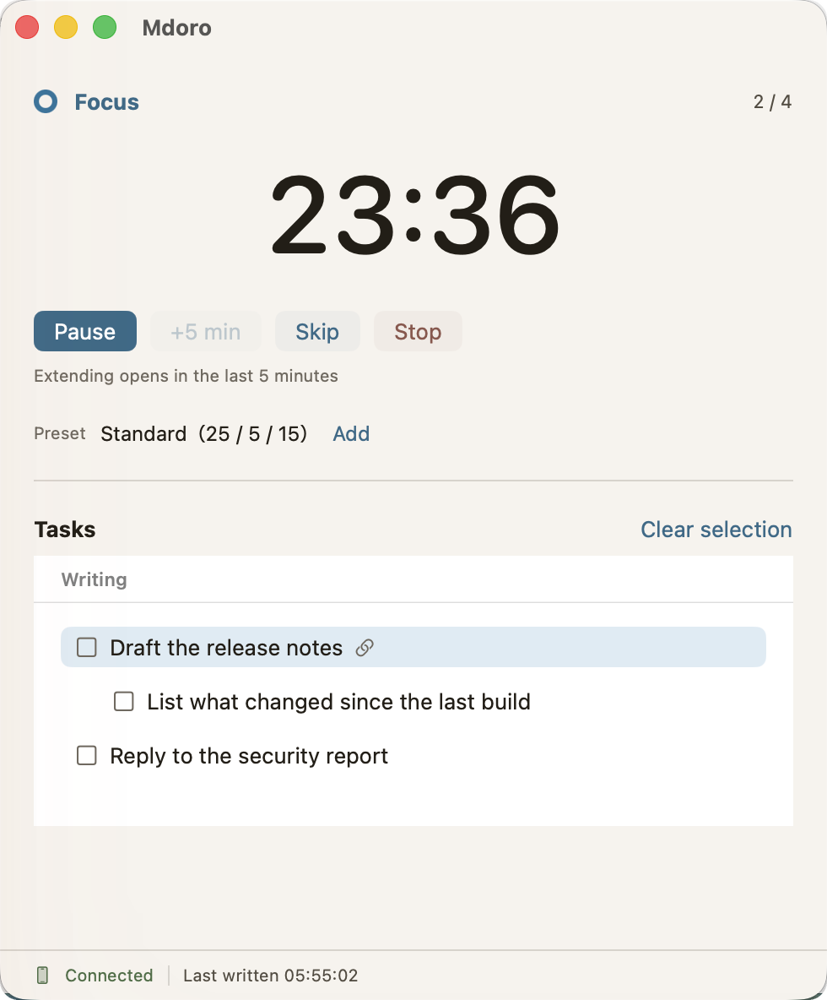
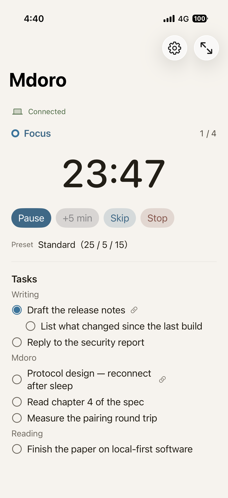
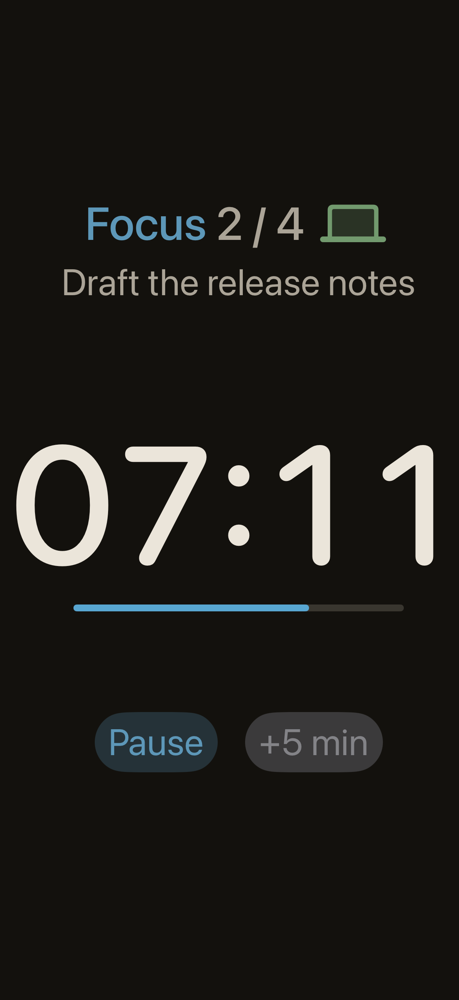

# Mdoro

A focus timer for people who keep their tasks in Markdown.

The Mac holds the timer. The iPhone shows it and drives it. They find each other
over your local network and talk to nothing else.

Mdoro reads a Markdown file you already have, **read-only**, and appends what you
actually did to a log file next to it. It never edits your tasks.

<p align="center">
  
  &nbsp;&nbsp;
  
</p>

---

## What it does

- **The Mac is the source of truth.** Loop counts, session ends and log writes are
  decided in one place, so the two devices can never disagree about what happened.
- **Times are absolute.** Remaining seconds are never synchronised; the end time is,
  and each device counts down to it on its own.
- **Your task file is read-only.** Mdoro has no code path that writes to it.
- **The link between the two devices is not encrypted.** It never leaves your local network,
  but on that network it is readable - see [SECURITY.md](SECURITY.md).
- **Sessions are appended to a log**, one line each, under a heading for the day.

```markdown
## 2026-08-24 (Mon)

- 09:00–09:25 WORK 25m ✅ Loop 1/4 [Standard] — Review the spec
- 09:25–09:30 SHORT_BREAK 5m ✅ [Standard]
- 09:32–10:04 WORK 32m ✅ Loop 2/4 (+7m extended) [Standard] — Protocol design
- 10:04–10:09 SHORT_BREAK 5m ⏭ Skipped [Standard]
- 11:35–11:43 WORK 8m ⏹ Stopped [Standard] — Protocol design
```

## From the menu bar

The window is optional. The menu bar carries the session, and the controls sit
behind it, ordered by what they cost you if you hit them by mistake.

<p align="center">
  
</p>

Pause, start and skip are one click. Stopping a session and resetting the loop
count ask once before they happen. Editing presets, changing file paths and
pairing are not here at all — they live in the window, where you can see what
you are doing.

## What it does not do

- **No cloud, no account, no sync service.** Everything happens on your LAN.
- **No telemetry, no analytics, no crash reporting.**
- **No ads, no subscription, no in-app purchase.**
- It does not edit your tasks. Creating and completing them stays in your editor.
- It does not work outside your local network, and it pairs one Mac with one iPhone.
- The interface is English only.

## The Markdown it reads

Any Markdown file. Mdoro reads **standard checkbox list items** and nothing else:

```markdown
## Today

- [ ] Review the spec ^abc123
  - [ ] Read chapter 4
- [ ] Protocol design
- [x] Already done
```

- `- [ ]`, `* [ ]` and `+ [ ]` are all tasks. Anything else in the file is ignored.
- Headings group tasks — any level, `#` through `######`. Tasks above the first
  heading land in `(Uncategorized)`.
- Indentation makes sub-tasks. The first indent width found in the file is one level.
- Any character other than a space in the box means done. Done tasks are hidden by default.
- **A trailing block ID (`^abc123`) keeps your selection when you reword a task.**
  It is optional, and it is the only tool-specific syntax Mdoro understands.
- Fenced code blocks are skipped, so a checklist inside one is not read as tasks.
- The first 1,000 tasks are loaded, and only the first 5MB of the file is read.
  Mdoro says so on screen when it hits either limit rather than quietly showing you less.

Tool-specific task markers (`TODO`, `DOING`, `id::`) are **not** read. If a file
works in Obsidian, Logseq, or a plain editor, it works here — because Mdoro only
relies on what all of them share.

## On the iPhone

The lock screen carries the session, so the phone can stay face down. While a
session is running, the full-screen button opens a view stripped down to the
clock, the task and the controls that still apply.

<p align="center">
  
  &nbsp;&nbsp;
  
</p>

The iPhone never decides anything. It draws the countdown between updates, but the
session ends, the loop advances and the log is written on the Mac.

## What it asks of your Mac

A timer that only draws a countdown would ask for none of this, so it is worth
knowing before you run it.

| What | When | How far it reaches |
| :---- | :---- | :---- |
| **Keeping the Mac from idling to sleep** | The whole time a session is running | **The machine, not just this app.** It shows up in `pmset -g assertions` as "A session is running". The display still sleeps, and there is no setting to turn this off — it is tied to the timer being in RUNNING |
| **One TCP listener, on every interface** | Only once an iPhone is paired — before that, only while the pairing screen is open | The WebSocket the iPhone talks over. This is what the local network prompt is asking about. **A Mac you never pair raises nothing**, so using Mdoro on its own costs you no open port |
| **A Bonjour advertisement** | Whenever that listener is up | Your LAN. Anyone browsing it sees the name you chose — **`Mdoro` by default, not your Mac's own name** — along with the port, the protocol version, and an id for this Mac. Nothing has to pair first to see that much |
| **Notifications** | Permission at launch; then when a session ends, and before it does if you asked for that | **The name of the task appears in the body when a work session ends** — not on a break ending, and not in an "ending soon" — so it stays in Notification Centre and shows on the lock screen according to your preview setting |
| **A global hotkey, up to four** | Only for the ones you assign | System-wide, so they win over whatever app you are in. All four are unset until you set them |
| **A login item** | Only if you switch it on | The app appears in System Settings → General → Login Items |
| **Read-only access to your task file, read-write to your log folder** | When you pick them | Only the folders you pick, through bookmarks macOS remembers. The task file's bookmark is created read-only at the OS level |

Nothing above leaves your LAN, and none of it is optional in the sense of being
negotiable with a server somewhere — there is no server anywhere but your Mac.

## Requirements

- macOS 26 or later, iOS 26 or later
- Xcode 26 to build

## Building

Mdoro is not distributed as a signed binary. You build it yourself:

1. Clone the repository.

   ```bash
   git clone https://github.com/soh-arch/mdoro.git
   ```

2. Put your signing team in `Config/Signing.local.xcconfig`. A free Apple ID works,
   and git ignores the file, so your team id never reaches a diff.

   ```
   DEVELOPMENT_TEAM = ABCDE12345
   ```

   **Do not set the team under Signing & Capabilities in Xcode.** Xcode writes it
   back into `project.pbxproj`, where it overrides this file.

3. Open `PomodoroMac/PomodoroMac.xcodeproj`, run `MdoroMac`, then run `MdoroiOS` on
   your iPhone.
4. In the Mac app: Settings → Files, pick your task file and a folder for the log.
5. Settings → Connection → Start pairing, and enter the six-digit code on the iPhone.

**With a free Apple ID the iPhone app stops working after seven days.** Rebuild and
install it again from Xcode. This is Apple's limit on free provisioning, not a
choice Mdoro makes.

**If the app will not launch and a rebuild will not go through either, the phone may
have stopped trusting your developer account.** Unlike the seven-day case above,
rebuilding does not clear this one. On the iPhone: Settings → General → VPN & Device
Management, pick your account, trust it again, then build from Xcode. The message
that names the trust can take several minutes and a few attempts to appear, so an app
that simply will not start is usually what you see first. This has turned up right
after an iOS update, though nothing shows that an update causes it.

Run the tests with:

```bash
cd Packages/MdoroCore && swift test
```

## Privacy

Mdoro keeps a diagnostic log so a bug report can carry evidence. It is designed to
be pasted in public:

- **Task names, note contents, file paths, server names, device names and IP
  addresses are never written to it.** Tasks appear as the last four characters of
  an internal id, files as a four-digit digest of their path (`#a1b2`).
- Redaction happens when the line is written, not when the log is exported. There
  is no unredacted copy anywhere.
- It is capped at 2MB × 2 generations and never leaves your Mac unless you export
  it yourself. Settings → Files → Diagnostic log.

## Documentation

The specification, the decision records and the working notes live in `docs/` and
are **written in Japanese** — they are the author's working language. **Everything the
project ships is English**: identifiers, code comments, and every string the app itself
says. The requirement IDs are what the two have in common.

- `docs/SPEC.md` — the requirements, and the only normative document
- `docs/decisions/` — why things are the way they are
- `docs/CONTEXT.md` — current constraints, and the places that have broken before

## Support

Mdoro is free, carries no ads and asks for nothing. If it earns a place in your day:

<https://buymeacoffee.com/soh.arch>

The same link sits in the app under Settings → About, once, and nowhere else.

## License

MIT. See [LICENSE](LICENSE).
