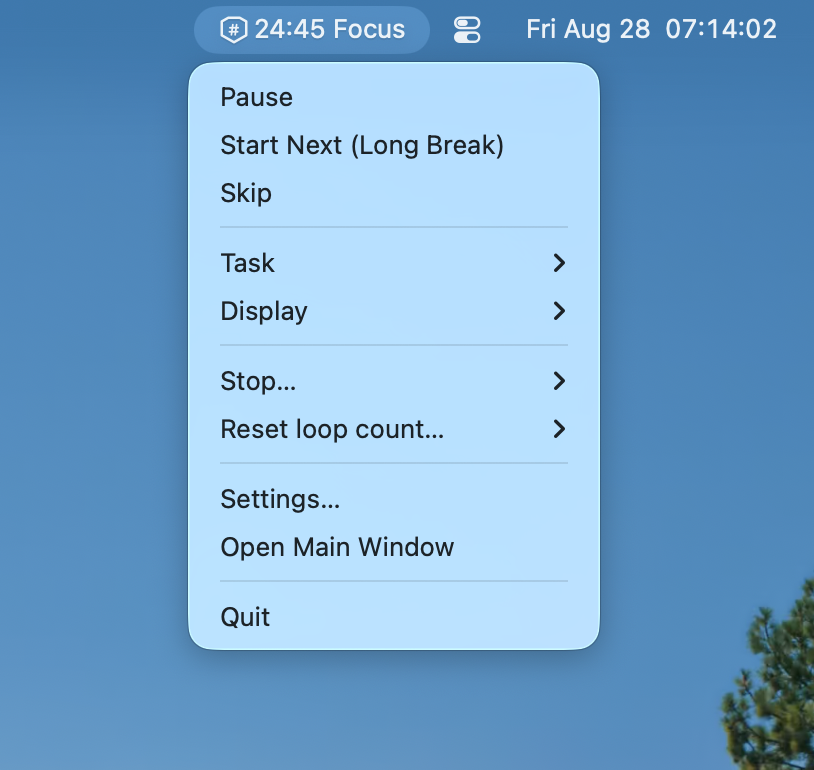
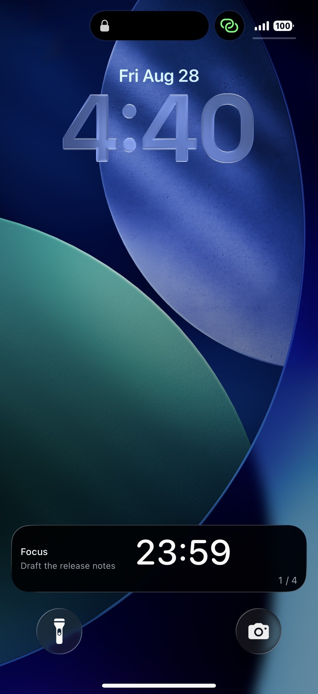

# Mdoro

A focus timer for people who keep their tasks in Markdown.

The Mac holds the timer. The iPhone shows it and drives it. They find each other
over your local network and talk to nothing else.

Mdoro reads a Markdown file you already have, **read-only**, and appends what you
actually did to a log file next to it. It never edits your tasks.

<p align="center">
  
  &nbsp;&nbsp;
  
</p>

---

## What it does

- **The Mac is the source of truth.** Loop counts, session ends and log writes are
  decided in one place, so the two devices can never disagree about what happened.
- **Times are absolute.** Remaining seconds are never synchronised; the end time is,
  and each device counts down to it on its own.
- **Your task file is read-only.** Mdoro has no code path that writes to it.
- **Sessions are appended to a log**, one line each, under a heading for the day.

```markdown
## 2026-08-24 (Mon)

- 09:00–09:25 WORK 25m ✅ Loop 1/4 [Standard] — Review the spec
- 09:25–09:30 SHORT_BREAK 5m ✅ [Standard]
- 09:32–10:04 WORK 32m ✅ Loop 2/4 (+7m extended) [Standard] — Protocol design
- 10:04–10:09 SHORT_BREAK 5m ⏭ Skipped [Standard]
- 11:35–11:43 WORK 8m ⏹ Stopped [Standard] — Protocol design
```

## From the menu bar

The window is optional. The menu bar carries the session, and the controls sit
behind it, ordered by what they cost you if you hit them by mistake.

<p align="center">
  
</p>

Pause, start and skip are one click. Stopping a session and resetting the loop
count ask once before they happen. Editing presets, changing file paths and
pairing are not here at all — they live in the window, where you can see what
you are doing.

## What it does not do

- **No cloud, no account, no sync service.** Everything happens on your LAN.
- **No telemetry, no analytics, no crash reporting.**
- **No ads, no subscription, no in-app purchase.**
- It does not edit your tasks. Creating and completing them stays in your editor.
- It does not work outside your local network, and it pairs one Mac with one iPhone.
- The interface is English only.

## The Markdown it reads

Any Markdown file. Mdoro reads **standard checkbox list items** and nothing else:

```markdown
## Today

- [ ] Review the spec ^abc123
  - [ ] Read chapter 4
- [ ] Protocol design
- [x] Already done
```

- `- [ ]`, `* [ ]` and `+ [ ]` are all tasks. Anything else in the file is ignored.
- `##` headings group tasks. Tasks above the first heading land in `(Uncategorized)`.
- Indentation makes sub-tasks. The first indent width found in the file is one level.
- Any character other than a space in the box means done. Done tasks are hidden by default.
- **A trailing block ID (`^abc123`) keeps your selection when you reword a task.**
  It is optional, and it is the only tool-specific syntax Mdoro understands.

Tool-specific task markers (`TODO`, `DOING`, `id::`) are **not** read. If a file
works in Obsidian, Logseq, or a plain editor, it works here - because Mdoro only
relies on what all of them share.

## On the iPhone

The lock screen carries the session, so the phone can stay face down. Tapping the
timer opens a full-screen view that is only a clock, a task and one control.

<p align="center">
  
  &nbsp;&nbsp;
  
</p>

The iPhone never decides anything. It draws the countdown between updates, but the
session ends, the loop advances and the log is written on the Mac.

## Requirements

- macOS 26 or later, iOS 26 or later
- Xcode 26 to build

## Building

Mdoro is not distributed as a signed binary. You build it yourself:

1. Clone the repository and open `PomodoroMac/PomodoroMac.xcodeproj`.

   ```bash
   git clone https://github.com/soh-arch/mdoro.git
   ```

2. Select your team under Signing & Capabilities for `MdoroMac`, `MdoroiOS` and
   `MdoroWidget`. A free Apple ID works.
3. Run `MdoroMac`, then run `MdoroiOS` on your iPhone.
4. In the Mac app: Settings → Files, pick your task file and a folder for the log.
5. Settings → Connection → Start pairing, and enter the six-digit code on the iPhone.

**With a free Apple ID the iPhone app stops working after seven days.** Rebuild and
install it again from Xcode. This is Apple's limit on free provisioning, not a
choice Mdoro makes.

Run the tests with:

```bash
cd Packages/MdoroCore && swift test
```

## Privacy

Mdoro keeps a diagnostic log so a bug report can carry evidence. It is designed to
be pasted in public:

- **Task names, note contents, file paths, server names, device names and IP
  addresses are never written to it.** Tasks appear as the last four characters of
  an internal id, files as a four-character digest of their path.
- Redaction happens when the line is written, not when the log is exported. There
  is no unredacted copy anywhere.
- It is capped at 2MB × 2 generations and never leaves your Mac unless you export
  it yourself. Settings → Files → Diagnostic log.

## Documentation

The specification, the decision records and the working notes live in `docs/` and
are **written in Japanese** - they are the author's working language. The code
comments are Japanese for the same reason. Everything the app itself says is English.

- `docs/SPEC.md` — the requirements, and the only normative document
- `docs/decisions/` — why things are the way they are
- `docs/CONTEXT.md` — current constraints, and the places that have broken before

## Support

Mdoro is free, carries no ads and asks for nothing. If it earns a place in your day:

<https://buymeacoffee.com/soh.arch>

The same link sits in the app under Settings → About, once, and nowhere else.

## License

MIT. See [LICENSE](LICENSE).
